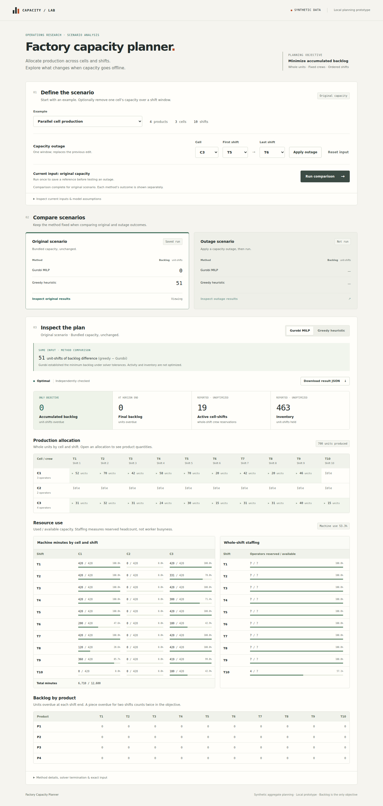

# Factory Capacity Planner

A small local planning tool: **what should each manufacturing cell produce in each shift when capacity and operators are limited?** A Python/Gurobi MILP minimizes overdue demand, and a React page explores synthetic equipment-outage scenarios. A deterministic greedy planner provides a feasible comparison.

This is aggregate production allocation with fictional data. It is not a Tesla system or a detailed machine schedule. Backlog is the **only** optimized measure; inventory and cell activity are descriptive.



## Run locally

Verified on Linux x86_64 with Python 3.12, Gurobi 14.0.0 and Node 24. A usable local Gurobi license is needed for optimization. The bundled small models solved successfully in the implementation environment; that does not establish license availability on another machine.

```bash
python3.12 -m venv .venv
.venv/bin/python -m pip install -r requirements.lock
.venv/bin/python -m pip install -e . --no-deps
.venv/bin/planner solve --example tiny --output artifacts/tiny.json
.venv/bin/planner check artifacts/tiny.json
```

A successful tiny solve has `status: "optimal"`, objective `0` and a valid independent check. If the solver is unavailable, the JSON result reports it explicitly. Greedy runs and core tests do not initialize Gurobi:

```bash
.venv/bin/planner solve --example lookahead --algorithm greedy --output artifacts/greedy.json
.venv/bin/planner example base --output artifacts/input.json
.venv/bin/planner validate artifacts/input.json
```

Start the API in one terminal and the frontend in another:

```bash
.venv/bin/uvicorn capacity_planner.api:app --host 127.0.0.1 --port 8011 --workers 1
```

```bash
cd frontend
npm ci
npm run dev -- --host 127.0.0.1 --port 5173
```

Open **http://127.0.0.1:5173 on that machine**. The Vite proxy forwards `/api` to port 8011. When running on Homeserver, use an SSH tunnel or your existing development port forwarding; for example, replace the hostname below with your SSH destination:

```bash
ssh -N -L 5173:127.0.0.1:5173 georgetrump@YOUR_HOMESERVER
```

Then visit http://127.0.0.1:5173 on the device holding that tunnel. No public deployment or hosted solver service is included.

## Demonstration

1. Select the base example and run both methods on the original input.
2. Apply a C3 outage in shifts 5–6 and run the edited input. The optimizer can prepare stock ahead of the outage; greedy does not plan ahead.
3. Extend the C3 outage to the whole horizon. Product P4 loses its only eligible cell, so some backlog is unavoidable.
4. Select the tiny lookahead example to explain the optimizer/greedy difference without a large table.
5. Inspect the allocation, stock, resources and solver details. Export a result and check its included input using `planner check`.

Use the method comparison on identical inputs. Changes in inventory or active cells are **not efficiency improvements** because those measures are not minimized. Edits after a run make its displayed input stale; saved results always contain the snapshot actually solved.

## CLI

```bash
.venv/bin/planner solve --example base --algorithm gurobi --outage-cell C3 --outage-start 5 --outage-end 6 --output artifacts/outage.json
.venv/bin/planner solve --input artifacts/input.json --algorithm greedy --output artifacts/reference.json
.venv/bin/planner check artifacts/outage.json
```

`planner check` verifies feasibility, objective arithmetic and metrics. It does **not** independently certify optimality or authenticate externally edited solver metadata. A solve time limit defaults to 10 seconds (`--time-limit 1..60`); it is not a hard end-to-end deadline for model construction, licensing or HTTP. A browser timeout does not cancel backend work.

## Tests and results

```bash
.venv/bin/python -m pytest -q -m 'not gurobi'
.venv/bin/python -m pytest -q -m gurobi
.venv/bin/python scripts/record_results.py
cd frontend
npm run build
```

Licensed tests explicitly skip when Gurobi cannot initialize; inspect the test summary. The first command is solver-free and proves no real optimizer execution. The recording script requires actual Gurobi solves, rechecks every plan and writes exact input/result snapshots to [docs/results](docs/results).

Observed primary objectives from the recorded synthetic cases:

| Input | Gurobi backlog unit-shifts | Greedy backlog unit-shifts | Final backlog, Gurobi / greedy |
| --- | ---: | ---: | ---: |
| Base | 0 | 51 | 0 / 3 |
| C3 outage, shifts 5–6 | 0 | 128 | 0 / 20 |
| C3 outage, all ten shifts | 550 | 550 | 100 / 100 |
| Lookahead | 0 | 1 | 0 / 1 |
| Tiny | 0 | 0 | 0 / 0 |

These are small, checked demonstrations, not industrial performance or timing claims. The baseline is intentionally myopic and locally greedy. See [model and results](docs/model-and-results.md) for equations, assumptions, proof examples and interpretation. Runtime observations, settings and actual solver status are stored with the results; equivalent primary-optimal allocations may differ.

The [expanded benchmark report](docs/benchmark-report.md) adds **13 fixed synthetic inputs, three methods and three measured repeats (117 runs)**, including a stronger solver-free dispatch portfolio and cases up to the application ceiling of eight products, six cells and twenty shifts. All 117 plans passed independent feasibility checks. Gurobi proved optimality in 33 runs; six reached the two-second optimization limit with feasible incumbents that were **not proven optimal**. On the largest disrupted case, checked backlog was 13 for Gurobi, 573 for the portfolio and 3,064 for original greedy; the Gurobi lower bound was 0. Runtime tradeoffs and all ties/weaker outcomes are included in the report. These remain synthetic observations on one shared host.

```bash
.venv/bin/python scripts/run_benchmarks.py --output-dir artifacts/my-benchmarks --repeats 3 --time-limit 2
```

Use a fresh output directory. The runner records exact fixtures/source hashes, full checked plans, solver bounds/gaps, statuses/failures, excluded warmups, rotated method order and wall/solver times. The portfolio is a benchmark-only method; the dashboard and API still offer the original two algorithms.

Verification on 18 November 2026: 56 Python tests passed, including real Gurobi integration and nine benchmark checks. Earlier implementation verification passed the React/TypeScript production build, a clean wheel installation solving/rechecking the tiny example, and live desktop/mobile checks with exact-input downloads. The [independent implementation review](docs/implementation-review.md) additionally checked 80 enumerated small scenarios and records the resolved findings and verification limits. CI configuration is included; no remote CI run is claimed.

Three [Chromium regression tests](docs/ui-regression-tests.md) also passed locally. They exercise the real React interface with replayed checked HTTP results, including stale snapshots, exact downloads and selected failure handling; they require no solver license. After the browser setup in those notes, run `npm run test:e2e` from `frontend/`. Deliberate stale-label and export-input defects were both detected before restoring the source. CI is configured to run the suite; no remote execution is claimed.

Dependency note (18 November 2026): `npm audit --omit=dev` reports no runtime findings. The full audit flags the development glob tool `picomatch@4.0.7` ([advisory](https://github.com/advisories/GHSA-fc5q-39xc-vjpf)) and its dependency chain. It is used by build/dev tooling, not by the planning API or browser input. The locked toolchain retains this finding; no forced downgrade was applied. Keep the development server on loopback as documented.

## Small architecture

`schema.py` validates strict integer inputs; `model.py` builds and solves the MILP; `greedy.py` supplies the reference; `check.py` independently recomputes physical constraints and metrics. CLI and API call the same core. The API is synchronous, loopback-only by default, with a nonblocking lock within one server process. There are no job queues, child solver processes or restart-resume promises.

## Contribution and learning status

Use the [interactive interview learning guide](docs/interview-guide.html) for a complete path from the planning question through the model, code, checked results, benchmark limits, dashboard state and regression tests. Open it directly in a browser: it is self-contained and works offline. Eleven lessons include a tiny exact-enumeration lab, real outage constructions, a code explorer, fourteen mock interview prompts and a locally saved personal practice journal. Lesson marks and practice answers are self-reports, not verification of mastery, authorship or interview readiness.

Start with the [guided code walkthrough and model-change exercise](docs/learning-walkthrough.md). It traces one unit through the application, reproduces the lookahead comparison and demonstrates how forbidding preproduction changes the tiny model's optimum from 0 to 1. The [teaching script](scripts/learning_inventory_limit.py) is isolated from the app; its outputs explicitly record the additional constraint.

This implementation was produced with substantial Codex assistance, including a delegated React implementation and an independent review. The saved project plan and design reviews informed it. George confirmed OR coursework and basic Gurobi familiarity, but his independent review, understanding and modification of this code have not yet been established. Existing application documents have not been expanded to claim this assisted implementation as independently completed work.

Before presenting it in an interview, trace the model and checker, explain the baseline failure, reproduce an experiment and make a small change yourself. No CP-SAT, individual workforce scheduling, measured energy savings or factory deployment is claimed.
